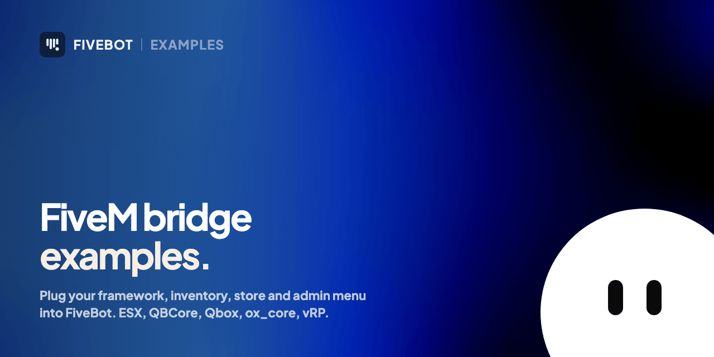

# FiveM bridge examples

Lua examples for `fivebot_bridge`, the FiveM resource that connects your game server to [FiveBot](https://fivebot.ai/?utm_source=github&utm_medium=referral&utm_campaign=fivem_bridge_examples). The bridge finds ESX, QBCore, Qbox, ox_core and vRP on its own, along with common inventories, ambulance scripts, txAdmin, Tebex and the big anticheats. The examples are for scripts it can't recognize: your own core, a store it doesn't know, a custom admin menu or dispatch.

## Start

1. Download the bridge from the FiveBot dashboard under Settings › Game Server Bridge and add its lines to `server.cfg` (below).
2. Copy [`fivebot_bridge_custom`](fivebot_bridge_custom) next to `fivebot_bridge` in `resources/`.
3. Delete the files you don't need. In the rest, change the resource name at the top and the export calls to the ones your script has.
4. Add `ensure fivebot_bridge_custom` after `ensure fivebot_bridge`.

Each file plugs in one thing and stays idle until you point it at a script your server runs, so the folder is safe to start as it is. Bridge updates never touch it.

```cfg
set fivebot_api_url       "https://api.fivebot.ai"
set fivebot_server_token  "srv_..."
set fivebot_shared_secret "..."

ensure fivebot_bridge
ensure fivebot_bridge_custom
```

The token and secret come from the dashboard. Keep them in `server.cfg`, never inside a resource, because resources get zipped and shared.

## Examples

| File | Plugs in | What FiveBot does with it |
| --- | --- | --- |
| [`framework.lua`](fivebot_bridge_custom/server/framework.lua) | Your own core: character, money, job | AI characters greet players by job, and the owner assistant reads and changes money and jobs |
| [`inventory.lua`](fivebot_bridge_custom/server/inventory.lua) | An inventory the bridge doesn't detect | Items on the player card, giving and taking items |
| [`medical.lua`](fivebot_bridge_custom/server/medical.lua) | Revive and heal | Owner assistant revives, AI medics |
| [`dispatch.lua`](fivebot_bridge_custom/server/dispatch.lua) | Your dispatch script | Calls AI characters make to police or EMS |
| [`currency.lua`](fivebot_bridge_custom/server/currency.lua) | Coins or tokens from your shop | The owner assistant reads and changes them |
| [`payments.lua`](fivebot_bridge_custom/server/payments.lua) | A store other than Tebex or Skalp | "My purchase never arrived" tickets, and sending it again once the owner approves |
| [`moderation.lua`](fivebot_bridge_custom/server/moderation.lua) | Your admin menu or anticheat | Bans, warnings and lifts reach FiveBot, the owner lifts a ban from the dashboard, and staff actions are logged |
| [`ticket_buttons.lua`](fivebot_bridge_custom/server/ticket_buttons.lua) | Game buttons on Discord tickets | Staff press Unban in the ticket and your script does it |
| [`assistant_actions.lua`](fivebot_bridge_custom/server/assistant_actions.lua) | Your own owner assistant actions | "Give Kuba a Sultan" runs your garage export |

Only `character` is required for a framework. Leave out what you don't have and the dashboard says that part isn't available yet. Return `false` when something can't be done, for example `removeMoney` when the player has less.

## Details

- `source` is the player's server ID. `account` is `cash`, `bank` or `dirty`.
- `key` is the ID your database keeps the character under.
- Payment `find` and `redeliver` may wait on HTTP and get 15 seconds each. Steam IDs come in hex, the way FiveM gives them.
- Ticket buttons and assistant actions call `done(true, message)` or `done(false, reason)` within 5 seconds. Event names can't start with `fivebot`, `txAdmin`, `__cfx` or other reserved prefixes.
- A plugged-in script wins over anything the bridge finds and is dropped when its resource stops.

## Extra server.cfg lines

| Line | When you need it |
| --- | --- |
| `add_filesystem_permission fivebot_bridge write monitor` | Links txAdmin, so FiveBot can lift bans and withdraw warnings |
| `add_ace resource.fivebot_bridge command.add_principal allow`<br>`add_ace resource.fivebot_bridge command.remove_principal allow` | QBCore and Qbox, to take staff permissions from a staff case |
| `add_ace resource.fivebot_bridge command.givecar allow` | An assistant action that runs an admin command (`givecar` here) |
| `set fivebot_blackbox false` | Turns off the 3-minute record that shows why an anticheat banned someone |

## Chat and notifications

The bridge sends every line through `client/chat.lua`, which stays readable in the protected build. To use another chat or notification resource, replace the body of `Chat.system` or `Chat.npc`:

```lua
exports.ox_lib:notify({ title = 'FiveBot', description = text })
TriggerEvent('okokChatV2:sendMessage', 'FiveBot', text)
TriggerEvent('esx:showNotification', text)
TriggerEvent('QBCore:Notify', text, 'primary')
```

## Requirements

- A FiveM server with OneSync (txAdmin turns it on by default)
- `fivebot_bridge` 0.31 or newer
- A FiveBot workspace. See [pricing](https://fivebot.ai/pricing?utm_source=github&utm_medium=referral&utm_campaign=fivem_bridge_examples).

Questions go to [Discord](https://discord.gg/fivebot) or support@fivebot.ai.

## License

[MIT](LICENSE)
